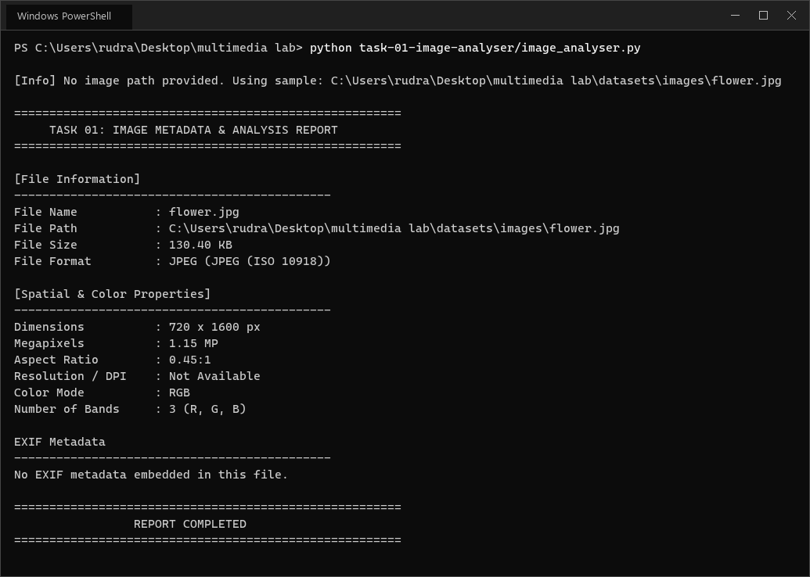
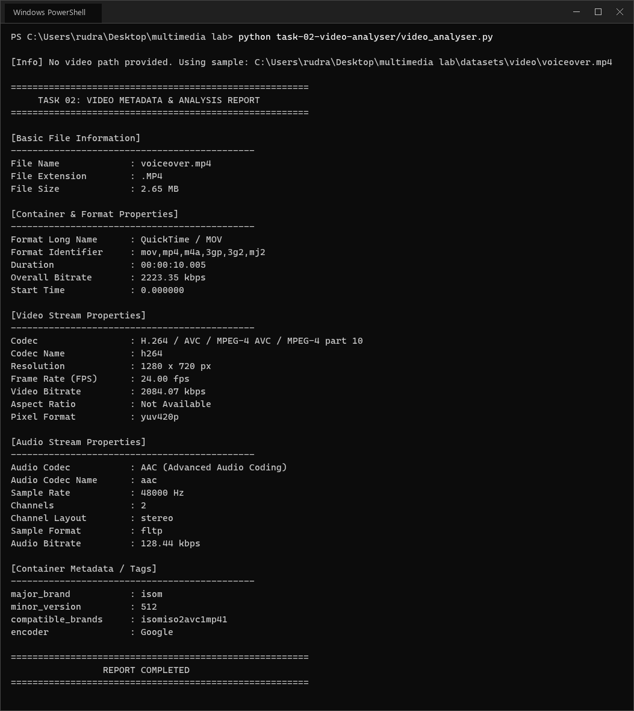
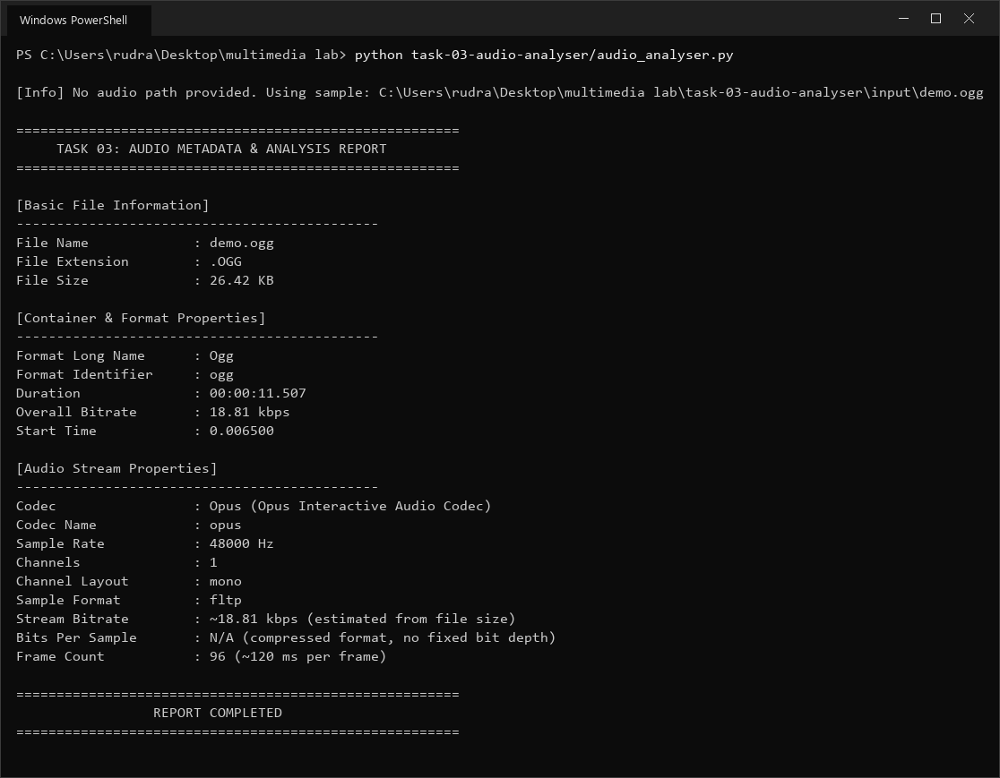
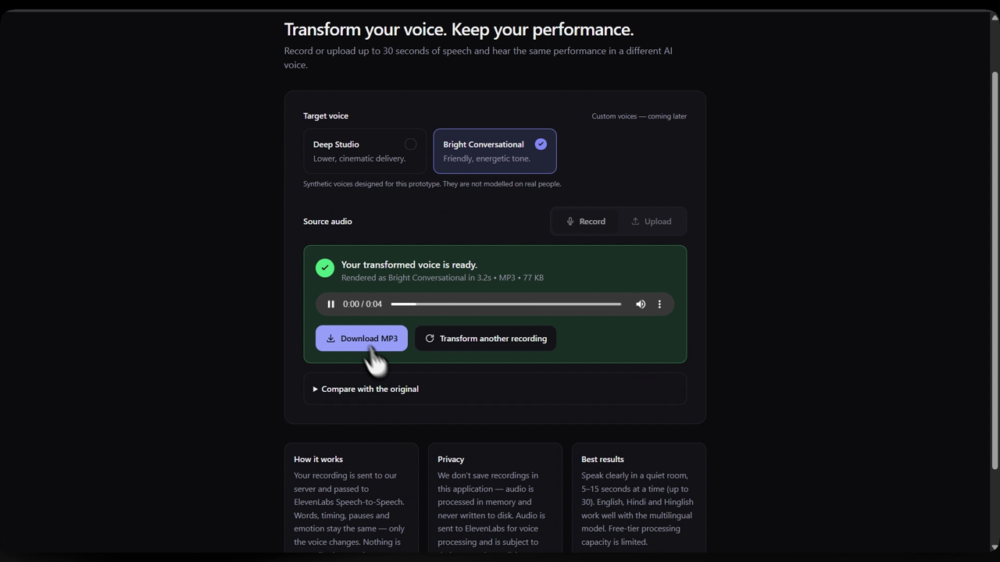

# Multimedia Systems Laboratory

[](https://github.com/Rudranshpardeshi09)
[](https://www.python.org/)
[]()
[]()

A clean, modular multimedia processing laboratory repository featuring implementations for **Image Spatial & EXIF Metadata Analysis**, **Video Stream Demuxing & Container Inspection**, **Audio Signal & ID3 Stream Analysis**, **AI Speech-to-Speech Voice Transformation**, and **Image Processing & Enhancement**.

---

## 📑 Table of Contents
- [Architecture & Repository Structure](#-architecture--repository-structure)
- [Prerequisites & Setup](#-prerequisites--setup)
- [Quick Start & Execution](#-quick-start--execution)
- [Core Lab Tasks](#-core-lab-tasks)
- [Datasets Catalog](#-datasets-catalog)
- [Git Workflow](#-git-workflow)
- [Author](#-author)

---

## 📂 Architecture & Repository Structure

```text
multimedia-lab/
├── .gitignore                          # Git ignore rules
├── README.md                           # This documentation
├── requirements.txt                    # Python dependencies
├── main.py                             # Central CLI task runner
│
├── task-01-image-analyser/             # 🖼️ Image Spatial & EXIF Metadata Analyzer
│   ├── image_analyser.py
│   ├── input/
│   │   └── bike.png
│   └── outputs/
│       └── task-01-image-analysis.png
│
├── task-02-video-analyser/             # 🎥 Video Stream Demuxer & Metadata Analyzer
│   ├── video_analyser.py
│   ├── input/                          # put the video to analyse here
│   └── outputs/
│       └── task-02-video-analysis.png
│
├── task-03-audio-analyser/             # 🎵 Audio Signal & Stream Properties Analyzer
│   ├── audio_analyser.py
│   ├── input/                          # put the audio file to analyse here
│   └── outputs/
│       └── task-03-audio-analysis.png
│
├── task-04-voice-transformer/          # 🗣️ AI Speech-to-Speech Voice Transformer
│   ├── voice_transformer.py            # CLI entry point (+ --serve for the web UI)
│   ├── .env.example                    # ElevenLabs key & voice IDs template
│   ├── vt/                             # config, voices, audio validation, providers, service, Flask server
│   ├── web/                            # index.html, styles.css, app.js (record / upload UI)
│   └── outputs/
│       └── task-04-demo.mp4            # screen recording of the web app
│
├── task-05-image-enhancement/          # 🖼️ Image Processing & Enhancement
│   ├── image_enhancer.py
│   ├── input/                          # put the image to enhance here
│   └── outputs/
│       └── testimage/before_after.png
│
├── datasets/                           # 🗂️ Categorized media assets
│   ├── images/                         # flower.jpg, flower2.jpg
│   ├── audio/                          # Afternoon_Window.mp3
│   └── video/                          # voiceover.mp4
│
└── tools/                              # 🛠️ Diagnostics
    └── env_checker.py                  # Environment & toolchain check
```

Each `outputs/` screenshot is an actual terminal run of that task against this
repository's own datasets.

---

## ⚙️ Prerequisites & Setup

| Requirement | Needed by | Notes |
| --- | --- | --- |
| Python >= 3.8 | All tasks | Tested on 3.13.2 |
| `Pillow` | Task 1 | From `requirements.txt` |
| **FFprobe** (FFmpeg) | **Task 2, Task 3, Task 4** | Without it Tasks 2/3 fall back to basic file info only; Task 4 needs it to probe durations |
| `requests`, `flask`, `python-dotenv` | Task 4 | From `requirements.txt` |
| `numpy`, `opencv-python-headless` | Task 5 | From `requirements.txt` |
| ElevenLabs API key (free plan) | Task 4 | Required - see the Task 4 setup below |

```bash
# 1. Virtual environment setup (Recommended)
python -m venv .venv
# Windows (PowerShell): .venv\Scripts\Activate.ps1
# Linux / macOS: source .venv/bin/activate

# 2. Install dependencies
pip install -r requirements.txt

# 3. Install FFmpeg / FFprobe (required for Task 2 & Task 3)
# Windows : winget install Gyan.FFmpeg
# macOS   : brew install ffmpeg
# Linux   : sudo apt install ffmpeg

# 4. Verify environment
python tools/env_checker.py
```

### Portable FFmpeg (no system install)

Instead of a system-wide install, a portable build can live in
`tools/ffmpeg/bin/` (`ffprobe.exe`, `ffmpeg.exe`). That folder is git-ignored,
so the binaries never enter the repository. Put it on `PATH` for the current
shell session before running Task 2 or Task 3:

```powershell
# Windows PowerShell - current session only
$env:PATH = "$PWD\tools\ffmpeg\bin;$env:PATH"
```

```bash
# macOS / Linux - current session only
export PATH="$PWD/tools/ffmpeg/bin:$PATH"
```

---

## 🚀 Quick Start & Execution

Launch any task or run all tasks using the central CLI runner:

```bash
# Interactive Selection Menu:
python main.py

# Direct Task Commands:
python main.py -t 1      # Run Task 1 (Image Analyzer)
python main.py -t 2      # Run Task 2 (Video Analyzer)
python main.py -t 3      # Run Task 3 (Audio Analyzer)
python main.py -t 4      # Run Task 4 (Voice Transformer CLI)
python main.py -t 5      # Run Task 5 (Image Processing & Enhancement)
python main.py -t d      # Run Diagnostics (env_checker.py)
python main.py -t all    # Run all tasks & diagnostics in sequence
```

---

## 🎯 Core Lab Tasks

### 🖼️ Task 1: Image Spatial & EXIF Metadata Analyzer

- **Script:** [`task-01-image-analyser/image_analyser.py`](task-01-image-analyser/image_analyser.py)
- **Capabilities:** Analyzes format, resolution (DPI), dimensions, megapixels, aspect ratio, color mode and bands, plus embedded EXIF tags (Make, Model, Date Taken, Orientation, Software).
- **Supported formats:** JPG, JPEG, PNG, TIFF, TIF, WEBP, BMP, GIF

```bash
python task-01-image-analyser/image_analyser.py
# With a custom image:
python task-01-image-analyser/image_analyser.py --file datasets/images/flower2.jpg
```

Run against `task-01-image-analyser/input/bike.png` (the default input):



| Property | Value |
| --- | --- |
| File Format | PNG (Portable network graphics) |
| File Size | 7.35 MB |
| Dimensions | 2752 x 1536 px |
| Megapixels | 4.23 MP |
| Aspect Ratio | 1.79:1 |
| Resolution | 2752 x 1536 px |
| DPI | 300 x 300 DPI |
| Print Size | 9.17 x 5.12 in (23.3 x 13.0 cm) @ 300 DPI |
| Color Mode | RGBA (4 bands) |
| EXIF | Not embedded in this file |

---

### 🎥 Task 2: Video Stream Demuxer & Metadata Analyzer

- **Script:** [`task-02-video-analyser/video_analyser.py`](task-02-video-analyser/video_analyser.py)
- **Capabilities:** Interrogates video containers via FFprobe, demuxes video and audio streams, and reports frame rate, resolution, aspect ratio, bitrates, pixel format and container tags.
- **Requires:** FFprobe on `PATH`

```bash
python task-02-video-analyser/video_analyser.py
# With a custom video:
python task-02-video-analyser/video_analyser.py --file path/to/video.mp4
```

Run against `task-02-video-analyser/input/final_POC-00350.mp4` (the script picks the first video in `input/` when no file is given):



| Property | Value |
| --- | --- |
| Container | QuickTime / MOV (`mov,mp4,m4a,3gp,3g2,mj2`) |
| File Size | 5.47 MB |
| Duration | 00:01:19.438 |
| Overall Bitrate | 577.30 kbps |
| Video Codec | H.264 / AVC / MPEG-4 part 10 (`h264`) |
| Resolution | 1280 x 720 px @ 60.00 fps |
| Aspect Ratio | 16:9 (1.78:1) |
| Video Bitrate | 436.95 kbps |
| Pixel Format | `yuv420p` |
| Audio Codec | AAC (`aac`), 48000 Hz, stereo |
| Audio Bitrate | 127.43 kbps |

---

### 🎵 Task 3: Audio Signal & Stream Properties Analyzer

- **Script:** [`task-03-audio-analyser/audio_analyser.py`](task-03-audio-analyser/audio_analyser.py)
- **Capabilities:** Extracts sample rate, channel layout, stream bitrate, sample format, bits-per-sample, duration and embedded ID3 / Vorbis tags.
- **Requires:** FFprobe on `PATH`

```bash
python task-03-audio-analyser/audio_analyser.py
# With a custom audio file:
python task-03-audio-analyser/audio_analyser.py --file path/to/audio.mp3
```

Run against `task-03-audio-analyser/input/demo.ogg` (the script picks the first audio file in `input/` when no file is given):



| Property | Value |
| --- | --- |
| Container | Ogg (`ogg`) |
| File Size | 26.42 KB |
| Duration | 00:00:11.507 |
| Overall Bitrate | 18.81 kbps |
| Codec | Opus (Opus Interactive Audio Codec) |
| Sample Rate | 48000 Hz |
| Channels | 1 (mono) |
| Sample Format | `fltp` |
| Stream Bitrate | ~18.81 kbps (estimated from file size) |
| Bits Per Sample | N/A (compressed format) |
| Frame Count | 96 (~120 ms per frame) |
| Tags | None embedded in this file |

---

### 🗣️ Task 4: AI Speech-to-Speech Voice Transformer

- **Script:** [`task-04-voice-transformer/voice_transformer.py`](task-04-voice-transformer/voice_transformer.py)

You speak into the mic (or upload a clip), choose a voice, and the AI says the
same thing back in that voice. The words, pauses and emotion stay yours; only
the voice changes. The conversion is done by the
[ElevenLabs](https://elevenlabs.io) Speech-to-Speech API.

This is a Python version of the
[voice-transformer](https://github.com/ARPANPATRA111/mm-lab/tree/main/voice-transformer)
web app from the mm-lab repo.

**Demo** - click the image to watch the video:

[](task-04-voice-transformer/outputs/task-04-demo.mp4)

#### Setup

1. Create a free account at [elevenlabs.io](https://elevenlabs.io) and make an API key.
2. Copy `task-04-voice-transformer/.env.example` to `task-04-voice-transformer/.env`.
3. Paste your key after `ELEVENLABS_API_KEY=` and add at least one voice ID.
   These two built-in voices work on the free plan:
   - George (deep): `JBFqnCBsd6RMkjVDRZzb`
   - Sarah (bright): `EXAVITQu4vr4xnSDxMaL`

`.env` is git-ignored, so your key never gets pushed.

#### Run it

```bash
# Web app - open http://127.0.0.1:5000, record, pick a voice, click Transform
python task-04-voice-transformer/voice_transformer.py --serve

# Or convert a file from the terminal
python task-04-voice-transformer/voice_transformer.py --file my_voice.wav --voice deep-studio
```

Clips can be up to 30 seconds long (MP3, WAV, M4A, OGG, FLAC or WebM). The
dataset song is 30.8 s, so add `--trim 10` if you use it. The result is saved
as an MP3 in `task-04-voice-transformer/outputs/`.

> **Note:** your audio is sent to ElevenLabs for processing. Nothing is stored by this app.

---

### 🖼️ Task 5: Image Processing & Enhancement

- **Script:** [`task-05-image-enhancement/image_enhancer.py`](task-05-image-enhancement/image_enhancer.py)
- **Basic processing:** grayscale, half-size resize, threshold (128), Gaussian blur (radius 2), Canny edges (100, 200), 90° clockwise rotation. The operations and parameters follow the mm-lab [Cluster02 image-processing](https://github.com/ARPANPATRA111/mm-lab/tree/main/Cluster02-Image-Processing) script.
- **Enhancement:**
  - histogram equalization, applied to the brightness (Y) channel only so colours stay the same;
  - gamma correction (`--gamma`, default 0.7);
  - sharpening (unsharp mask);
  - median filter denoising (3x3).
- **Output:** every result is saved as PNG in `task-05-image-enhancement/outputs/<image-name>/`, along with a `before_after.png` that shows the original next to the equalized image.

```bash
python task-05-image-enhancement/image_enhancer.py
# With a custom image and gamma:
python task-05-image-enhancement/image_enhancer.py --file datasets/images/flower2.jpg --gamma 0.5
```

With no `--file`, the script uses the first image in `task-05-image-enhancement/input/`.

Run against `task-05-image-enhancement/input/testimage.jpeg` (4096 x 2304 px). Left: original, right: histogram equalized:


| Image | Brightness | Contrast | Sharpness |
| --- | --- | --- | --- |
| original | 135.19 | 72.74 | 518.0 |
| histogram_equalization | 128.08 | 73.66 | 600.2 |
| gamma_correction | 157.38 | 65.02 | 517.3 |
| sharpen | 135.78 | 77.73 | 2883.7 |
| median_denoise | 134.97 | 72.37 | 287.2 |

**Reading the table:**
- **Brightness** is the mean gray level. Gamma 0.7 brightens the image (135 → 157), and equalization pulls it slightly toward the middle.
- **Contrast** is the standard deviation. Sharpening raises it the most here (72.7 → 77.7); equalization adds a little, because this photo already uses most of the tonal range.
- **Sharpness** is the variance of the Laplacian. Sharpening raises it about 5.6x, while the median filter roughly halves it because it smooths out fine detail along with the noise.
---

## 🗂️ Datasets Catalog

Media assets under [`datasets/`](datasets/). Specifications below are the
measured values reported by the analyzers themselves.

### 🖼️ Images — [`datasets/images/`](datasets/images/)

| File | Format | Size | Dimensions | Mode | EXIF |
| --- | --- | --- | --- | --- | --- |
| `flower.jpg` | JPEG (ISO 10918) | 130.40 KB | 720 x 1600 px (1.15 MP) | RGB | None embedded |
| `flower2.jpg` | JPEG (ISO 10918) | 88.54 KB | 720 x 1600 px (1.15 MP) | RGB | None embedded |

### 🎵 Audio — [`datasets/audio/`](datasets/audio/)

| File | Container | Size | Duration | Codec | Sample Rate | Channels | Bitrate |
| --- | --- | --- | --- | --- | --- | --- | --- |
| `Afternoon_Window.mp3` | MP2/3 | 727.16 KB | 00:00:30.772 | MP3 | 44100 Hz | 2 (stereo) | 192.00 kbps |

### 🎥 Video — [`datasets/video/`](datasets/video/)

| File | Container | Size | Duration | Video | Audio |
| --- | --- | --- | --- | --- | --- |
| `voiceover.mp4` | QuickTime / MOV | 2.65 MB | 00:00:10.005 | H.264 1280 x 720 @ 24.00 fps, `yuv420p`, 2084.07 kbps | AAC 48000 Hz stereo, 128.44 kbps |

---

## 🛠️ Git Workflow

This repository is committed under a **personal** GitHub identity, set as a
repo-local override so a machine-wide (work) identity stays untouched:

```powershell
# Repo-local identity - overrides the global config for this repository only
git config --local user.name  "Rudranshpardeshi09"
git config --local user.email "rudranshpardeshi12@gmail.com"

# Verify which identity this repo will commit as
git config user.name; git config user.email
```

```powershell
# Standard commit & push cycle
git add -A
git commit -m "feat: describe the change"
git push origin main
```

> **Credentials:** keep the access token out of the remote URL. Use the OS
> credential helper instead, so nothing secret is stored in `.git/config`:
> ```powershell
> git config --global credential.helper manager
> git remote set-url origin https://github.com/Rudranshpardeshi09/Multimedia-lab.git
> ```

---

## 👤 Author
**Rudransh Pardeshi**
- GitHub: [@Rudranshpardeshi09](https://github.com/Rudranshpardeshi09)
- Email: `rudranshpardeshi12@gmail.com`
